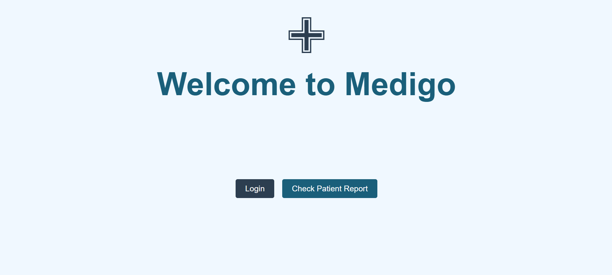

# MediGo - A Hospital Management System written in Go



🚀 A Golang web application that consists of a receptionist portal & doctor portal which performs the following tasks:

- A **single login page** for doctor and receptionist - **Receptionists** can add a new patient record, update records and delete records. **Doctors** can view registered patient-related details and diagnose based on symptoms. **Pateints** can check their report based on unique token ID.
- Google's Gemini is used as an **AI agent to diagnose and treat** based on symptoms.

## Deployment links

Frontend: https://medigo-frontend.vercel.app \
Backend: https://medigo-7u9l.onrender.com/

## 👨‍🚀 Postman Collection Documentation

[Postman Documentation URL](https://documenter.getpostman.com/view/40689865/2sB3HtHHfh)

## ✨Features and Best Practices

- **API Versioning** for backward compatibility
- **Caching** - To reduce server load
- **Dependency Injection** for modularity
- **JWT Authentication** for security
- **Persistant storage** using PostgreSQL
- **Pagination** - To efficiently handle and deliver large datasets
- **Rate Limit** - To protect server resources

## 🛡️Security

- **Rate Limit** to avoid API misuse and DDoS
- **Origin validator** to avoid accessing API other than allowed origins, not even postman
- **API read timeout** to avoid slowris attack
- **Input validation** to avoid SQL injection

## 📦 Tech Stack

- **Backend** : Golang
- **Frontend** : HTML/CSS/JavaScript
- **AI Assitant**: Google's Gemini
- **Caching** : Redis
- **Database** : PostgreSQL
- **Containerization** : Docker
- **Deployment** : Vercel (Frontend) + Render (Backend)

## How to run this application locally

### 1. Prerequisites

Make sure you have the `Docker Desktop` installed on your system:

### 2. Clone the Repository

```bash
git https://github.com/harshitrajsinha/medi-go.git
cd medi-go
```

### 3. Set up environment variable

Create .env file in root directory

```bash
ENVIRONMENT=production

# For postgres docker image
POSTGRES_USER=postgres
POSTGRES_PASSWORD=yourstrongpassword
POSTGRES_DB=yourfavouritedbname

# Data storage
DB_USER=postgres
DB_NAME=yourfavouritedbname
DB_PASS=yourstrongpassword
DB_PORT=5432
DB_HOST=db

# Neon cloud service (if configured)
NEON_CONNSTR=neon_cloud_connection

APP_PORT=8000

JWT_KEY = secretkeyword

REDIS_HOST=redis
REDIS_PORT=6379

MONITOR_KEY=secretkeyfordbstats

# Frontend application
ALLOWED_ORIGIN=http://localhost:3000
```

### 4. Run the application

Run the following command in your bash terminal

```bash
docker-compose up --build
```

## Receptionist Dashboard


## Doctor Diagnosis (using Gemini AI)


## Patient Report


